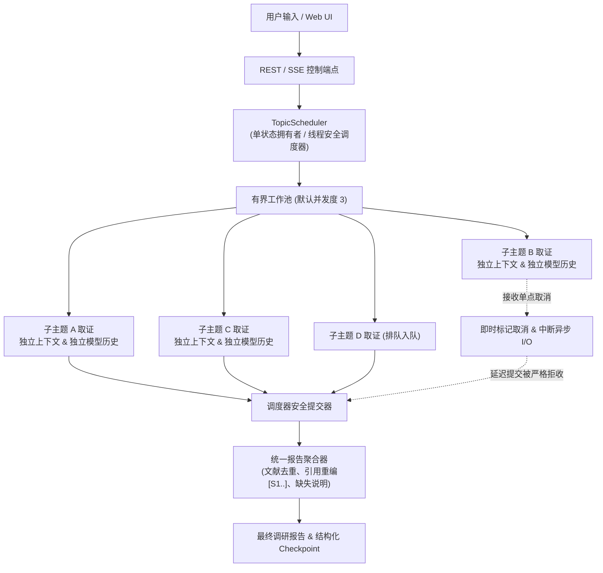

# 交互式异步主题研究 (Interactive Asynchronous Topic Research)

2026-10-12：生产调研已改为单 worker 严格顺序执行，取消/失败后在 Future 完成回调中释放容量；下文原有并发示意记录的是历史设计。arXiv 请求全进程串行、默认 HTTPS 直连；LLM 网络故障按 60 秒间隔最多重试 10 次。无候选论文或无实际全文索引时不得读取空索引或生成有证据的成功报告。

2026-10-08：论文笔记、证据反思与章节写作已抽取到 `agent/research_service.py`，由图节点和子主题调度器共用。调度、取消、幂等与恢复约束继续由本模块负责；输出偏好随调研快照保留。自动记忆候选改为用户主动保存笔记，详见 [功能精简说明](simplification-20261008.md)。

2026-10-08 入口统一：研究交互全部通过 Web/API；论文问答后端已迁至 `agent/runtime.py`。本调度器继续负责所有面向用户的主题研究，检索数量随快照保存并在恢复时沿用。见 [Web 统一说明](web-unification-20261008.md)。

## 1. 架构总览

本模块实现了 Web + API 架构下的交互式多主题学术研究运行控制器。一次父调研任务（`session_id`）可容纳多个独立的子主题（如 `a`, `b`, `c`）。在证据收集阶段，支持动态增加新子主题（如 `d`）以及单点取消特定子主题（如 `b`），最终由父级调度器将所有有效完成的子主题汇总为一份统一的学术调研报告。



---

## 2. 核心设计原则与保证

### 2.1 隔离性与资源管理
1. **模型会话与工具上下文隔离**：
   每个子主题拥有专有的 `ToolContext` 实例、专属的 `topic_id`，以及独立的 LLM 消息历史（不会互相串扰，也不会将各自的内部推理历史写入父会话 checkpoint）。
2. **向量索引与下载缓存分离**：
   - 全文向量数据库索引路径基于 `(session_id, run_id, topic_id)` 进行强隔离：`storage/vector_store/<session_id>/<run_id>/selected_papers_<topic_id>`。报告文件亦按运行隔离：`data/reports/<session_id>_<run_id>_<slug>.md`。多轮运行与主题索引互不串扰。
   - PDF 下载目录基于父会话共享：`data/downloads/<session_id>/`。已下载的文献缓存跨主题可复用，取消某个主题绝不会删除其他主题引用的物理文件。
3. **有界并发与非阻塞调度**：
   - 默认并发上限为 3（`DEFAULT_CONCURRENCY = 3`），排队中的主题（`queued`）在有容量释放时才启动，严格避免资源耗尽。
   - 网络请求退避（Backoff）与等待采用 `cancel_event.wait(timeout)`，在取消时能够毫秒级唤醒并立即退出。

### 2.2 单点取消与防脏写入（Late Completion Rejection）
1. **即时响应取消与生产工具链打通**：
   - 取消指令经调度器验证后立即置位 `topic._cancel_event`，并将主题状态标记为 `cancelled`。
   - 生产环境中各取证阶段（包括 `run_tool_loop`、`search_academic_topic`、PDF 下载等）均透传 `cancel_event` 与 `topic_id`，取消时快速中止，杜绝进入降级 fallback 或死灰复燃（resurrection）。
2. **分代校验（Generation Guard）**：
   - 每个主题拥有递增的分代编号 `generation`。如果旧分代在后台线程由于阻塞 I/O 延迟返回，调度器在提交阶段核对状态与分代编号，严格拒收过期脏数据。
3. **OpenAI Schema 工具调用配对**：
   - 当子主题在工具调用循环中被取消时，调度器会为该轮模型已发出的每个 `tool_call_id` 补齐模拟取消的 tool 响应消息，防止底层 LLM 出现未配对异常。
4. **父任务取消的单调终态保护**：
   - `cancel_run()` 具备单调终态防护（Monotonic Terminal State），如果任务已被取消，报告撰写完成时绝不会将状态覆盖为成功（SUCCEEDED），避免向用户呈现已被取消但被伪装为成功的产物。

### 2.3 容错与缺失说明
1. **局部故障隔离与有界重试**：
   - 子主题若遇偶发性异常（如网络波动），在锁外以非阻塞退避进行重试，不阻塞其他命令或并发主题；重试超限后标记为 `failed`，其余正常主题不受影响。
2. **报告覆盖度补偿**：
   - 取消的主题完全从报告正文范围中排除；仅故障失败（`failed`）的主题会在报告末尾生成 `[调研覆盖与缺失说明]`，清晰陈述故障原因，避免用户误判覆盖范围。
   - 若全部主题均被取消，整体任务直接以 `cancelled` 终态终止且不生成报告；若全部失败，如实返回故障汇总。

### 2.4 故障恢复与断点续跑（Restart & Resumption）
1. **指令持久化在先（Durable Before Acknowledged）**：
   - 调度器在接受添加主题、取消或状态流转时，必须先将 snapshot 原子写入持久化存储（`save_checkpoint`），持久化成功后才向调用方返回 `accepted`；持久化异常直接返回拒绝或报错。
2. **证据池完整序列化（Evidence & Citations Persistence）**：
   - `SubtopicState` 的序列化/反序列化完整保留各子主题的 `evidence_pool` 与 `citations`，即使服务重启也能完整恢复已完成主题的取证成果。
3. **多轮对话与断点续跑的精准区分**：
   - 区别“多轮对话新提问”与“中断任务续跑”：用户提交新问题（如 `query="second"`）即使带 `resume=True`，也会作为新一轮对话启动全新调研，绝不重复回放上一轮已完成的主题。
   - 仅当明确指定 `explicit_resume` 或从中断 checkpoint 恢复同一课题时，才从 `interrupted` 状态恢复。若所有主题此前均已完成，系统直接平滑过渡到报告撰写（WRITING）阶段，绝不卡死。

---

## 3. 控制指令语法与自然语言解析

系统内置中英文自然语言与结构化指令解析器（`parse_control_command`）：

| 用户自然语言 / 结构化指令 | 解析动作 | 说明 |
| :--- | :--- | :--- |
| `增加调研主题 DPO与RLHF对比` | `add` | 动态新增子主题，若并发已满则进入队列 |
| `add topic Multi-Agent Debate` | `add` | 英文等价语法 |
| `取消调研主题 topic-2` | `cancel` | 根据唯一主题 ID 精确取消 |
| `取消调研主题 强化学习对齐` | `cancel` | 根据主题名称模糊匹配；若多个主题同名则触发歧义澄清 |
| `cancel topic topic-1` | `cancel` | 英文精确取消 |
| `{"command": "resume"}` | `resume` | 显式恢复上次中断的调研 |

### 歧义处理与澄清
- 若用户输入的取消目标匹配到多个进行中或排队中的子主题，调度器返回 `status="clarification_needed"`，并在响应与 SSE 流中携带备选主题列表（`clarification_options`）。
- Web UI 会即时展示澄清操作按钮供用户单选确认。

---

## 4. API 接口参考

### 4.1 发送调研控制指令
`POST /api/sessions/{session_id}/research/commands`
或 `POST /api/jobs/{job_id}/commands`

**请求体**：
```json
{
  "command": "add_topic",
  "topic": "扩散模型在蛋白质预测中的应用",
  "command_id": "optional-idempotency-token"
}
```
或直接传入自然语言：
```json
{
  "raw_text": "增加调研主题 扩散模型在蛋白质预测中的应用"
}
```

**响应体**：
```json
{
  "command_id": "...",
  "status": "accepted",
  "message": "已成功添加调研主题",
  "topic_id": "topic-4",
  "topic_name": "扩散模型在蛋白质预测中的应用",
  "phase": "collecting",
  "clarification_options": []
}
```

### 4.2 查询当前调研状态（支持重连）
`GET /api/sessions/{session_id}/research/current`

**响应体**：
```json
{
  "session_id": "sess-xyz",
  "job_id": "job-123",
  "is_active": true,
  "phase": "collecting",
  "can_resume": false,
  "topics": [
    {
      "id": "topic-1",
      "name": "RLHF 对齐算法演进",
      "status": "completed",
      "latest_progress": "完成 3 篇文献要点提炼"
    },
    {
      "id": "topic-2",
      "name": "DPO 直接偏好优化",
      "status": "running",
      "latest_progress": "正在下载论文全文"
    }
  ]
}
```

---

## 5. 前端交互特性

1. **动态双模式输入框**：
   - 调研未启动时，输入框用于发起新的学术调研课题；
   - 调研进行中，输入框保持可编辑，提示词切换为“输入动态指令，例如：增加调研主题 d 或 取消调研主题 b”，回车即可下发指令且不中断当前任务流。
2. **子主题卡片与独立取消按钮**：
   - 实时呈现各子主题的执行状态（排队中、取证中、已完成、已取消、失败、已中断）。
   - 在取证收集阶段（collecting），排队中、运行中、已完成以及失败的主题均支持取消/移除操作并附带操作按钮，可精确调整有效调研范围。
3. **断点恢复横幅**：
   - 重新进入中断的会话时，界面自动检测并弹出“检测到上次未完成的调研任务（已中断）”提示条，支持一键点击“继续执行 (Resume)”。
